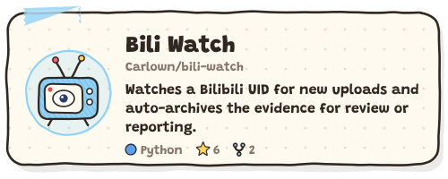
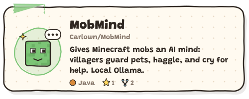

<!--
  Every illustration and animation on this page is drawn in code by scripts/build.py
  (assets/*.svg, a light set and a dark set).
  To change the copy or which projects are shown: edit profile.json and push — the
  GitHub Actions workflow regenerates everything automatically.
  The "What I'm building" block (projects:start ~ projects:end) is generated by the
  script, so don't edit it by hand.
-->

  <picture>
    <source media="(prefers-color-scheme: dark)" srcset="assets/hero-dark.svg">
    
  </picture>

  

### 🦀 About me

- 🔧 I build [**FlowBench**](https://github.com/Flowbench-Org/FlowBench) — a Windows desktop app for authorized network stress-testing & performance monitoring (Python · PySide6 · Fluent Design), with live charts and a built-in plugin marketplace.
- 🐍 Small **Python** tools for whatever itch: [Bili Watch](https://github.com/Carlown/bili-watch) keeps an eye on Bilibili uploads, [Phantom-Next](https://github.com/Carlown/phantom-next) is a different take on CAPTCHA.
- ⛏️ **Game mods**: [MobMind](https://github.com/Carlown/MobMind) gives Minecraft mobs an AI mind — villagers guard their pets, haggle, and yell for help when they catch fire.
- 🖥️ I keep a crayon crab named [Clawd](https://github.com/Carlown/clawd-pet) on my Windows desktop — he strolls around, and now he lives on this page too.
- 💋 Silly browser extensions that kiss your cursor, plus a [WebGAL visual novel](https://github.com/Carlown/nanhua-qiaoge-webgal).
- 💬 *Tinkering with Python and game mods for fun, building random side projects.*

### 🧰 Tools I reach for

  <picture>
    <source media="(prefers-color-scheme: dark)" srcset="https://skillicons.dev/icons?i=py%2Cjava%2Cjs%2Cts%2Chtml%2Ccss%2Csass%2Cnodejs%2Celectron%2Creact%2Cvite%2Ctailwind%2Cgradle%2Cdocker%2Cwindows%2Cgit&perline=8&theme=dark">
    
  </picture>

### 🎮 What I'm building

<!-- projects:start -->

<a href="https://github.com/Flowbench-Org/FlowBench"><picture><source media="(prefers-color-scheme: dark)" srcset="assets/project-FlowBench-dark.svg"></picture></a>
<a href="https://github.com/Carlown/clawd-pet"><picture><source media="(prefers-color-scheme: dark)" srcset="assets/project-clawd-pet-dark.svg"></picture></a>
 
<a href="https://github.com/Carlown/bili-watch"><picture><source media="(prefers-color-scheme: dark)" srcset="assets/project-bili-watch-dark.svg"></picture></a>
<a href="https://github.com/Carlown/MobMind"><picture><source media="(prefers-color-scheme: dark)" srcset="assets/project-MobMind-dark.svg"></picture></a>
 
<a href="https://github.com/Carlown/phantom-next"><picture><source media="(prefers-color-scheme: dark)" srcset="assets/project-phantom-next-dark.svg"></picture></a>
<a href="https://github.com/Carlown/nanhua-qiaoge-webgal"><picture><source media="(prefers-color-scheme: dark)" srcset="assets/project-nanhua-qiaoge-webgal-dark.svg"></picture></a>

Also: <a href="https://github.com/Carlown/deepseek-kisser">DeepSeek Kisser</a> · <a href="https://github.com/Carlown/fuck-huigezi">Huigezi RAT remover</a> · <a href="https://github.com/Carlown/huggingface-kisser">Hugging Face Kisser</a> · <a href="https://github.com/Carlown/majia7-dsh-skin">Majia7 DSH skin</a>

<!-- projects:end -->

### 📊 Adventurer Card

  <picture>
    <source media="(prefers-color-scheme: dark)" srcset="assets/stats-dark.svg">
    
  </picture>

### 🌱 Clawd on patrol

  <picture>
    <source media="(prefers-color-scheme: dark)" srcset="assets/contrib-dark.svg">
    
  </picture>

  <picture>
    <source media="(prefers-color-scheme: dark)" srcset="assets/footer-dark.svg">
    
  </picture>

